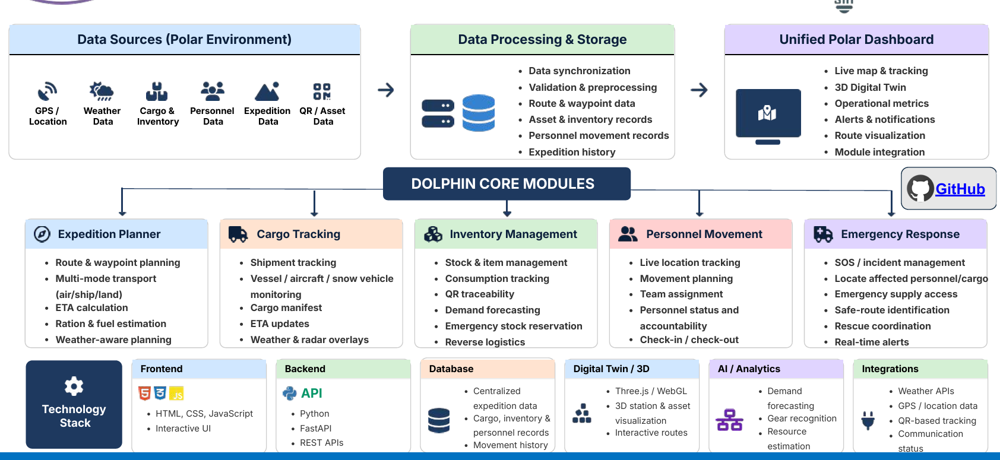
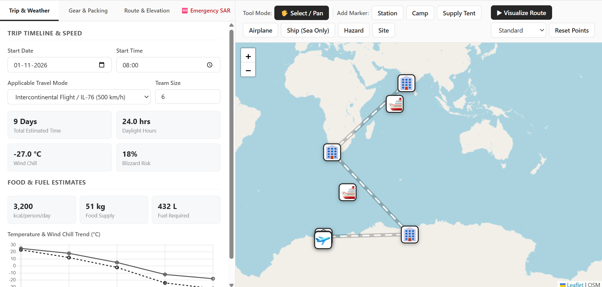
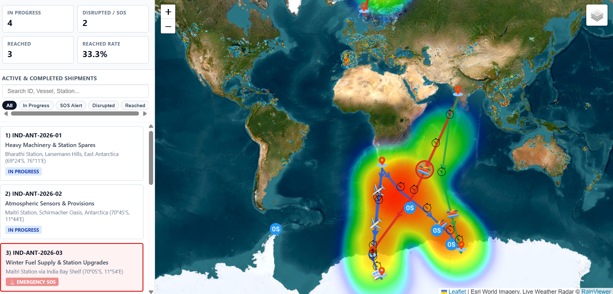
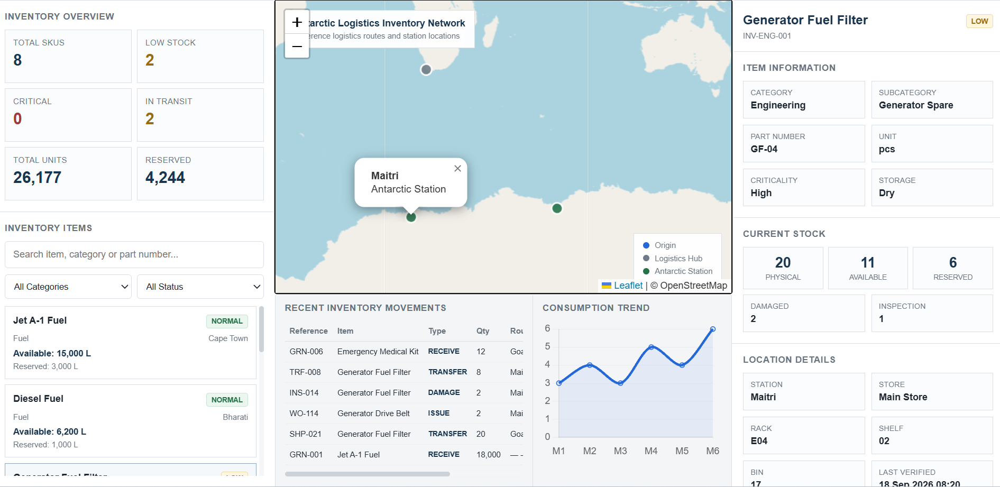
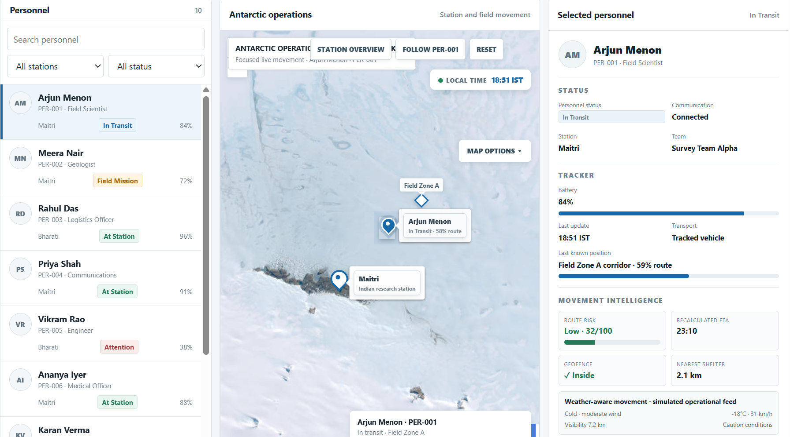

## **Team Name**: Dolphin
## **Team ID**: 143278

**Integrated Polar Expedition Logistics & Asset Management System (DOLPHIN)**

**Problem Statement ID**: 26062

**Theme**: Smart Automation | Category: Software

# Live Prototype: 

## https://dolphin-three.vercel.app/index.html

**What is DOLPHIN?**

Planning an expedition in the polar regions isn't like normal logistics—harsh weather, limited connectivity, and remote terrain make every decision critical.

DOLPHIN is a centralized digital platform built to take the chaos out of polar mission planning. It brings together route planning, cargo tracking, supply management, team safety, and emergency response into one straightforward, easy-to-use system.

**How it Works & Tech Architecture**
Right now, we are simulating the entire setup using clean HTML, CSS, and JavaScript pages. This lets us test and demonstrate the core workflows, UI layouts, and user interactions without needing a complex backend setup yet.

**Key Features**

**1. Expedition Planner**

Organizing a polar trip requires knowing exactly where you are going and what you need. This module helps teams plan routes, account for weather conditions, calculate travel times, and estimate fuel and food rations across air, land, and sea transport.

**2. Cargo Tracking**
Keep an eye on supplies while they are on the move. Track shipments across ships, planes, and snow vehicles, check live route updates, and monitor changing weather conditions along cargo paths.

**3. Inventory Management**

Never run out of vital gear. This tool lets teams monitor stock levels, scan items with QR codes, track daily consumption, and reserve emergency supplies so nothing gets overlooked.

**4. Personnel Movement & Safety**

Team safety is the highest priority. This module handles live location check-ins, team assignments, movement planning, and quick SOS alerts to make sure everyone is accounted for at all times.

